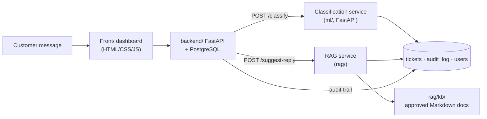

# Architecture View

**Version:** 0.1 — 2026-11-03
**Owner:** Member 4 (review & completion) · drafted by Hesham (Member 2)
**Status:** Draft for team review — this file describes both what exists today
and what lands in weeks 2–4.

## 1. Principles

1. **Contracts first.** Every cross-track boundary is a file in
   `docs/contracts/`; code implements the contract, never invents fields.
2. **Human in the loop.** The system suggests; the employee decides. Nothing
   is ever sent to a customer automatically.
3. **Per-language thinking.** `language` (`en` / `ar-msa` / `ar-eg`) is a
   first-class field in the data schema, the API, and every metric.
4. **Fixed vocabulary.** `category ∈ {payment, account, technical, delivery}`,
   `priority ∈ {low, medium, high}`, `status ∈ {open, in_progress, resolved}`
   (plus `human_review`/`routed` in static data — see the schema contract).

## 2. Components

| Component | Location | Stack | Status (2026-11-03) |
|---|---|---|---|
| Web dashboard | `Front/` | HTML/CSS/JS, deployed to GitHub Pages | Exists: dashboard + complaints list + filters + details + local demo actions; reads `GET /complaints` only |
| Backend API | `backend/` | Python FastAPI | Skeleton: `GET /health`, `GET /complaints` (sample data) |
| Database | docker-compose `db` service | PostgreSQL 16 | Service defined; tables/schema not yet created |
| Classification service | `ml/` → served via FastAPI | TF-IDF + LogReg baseline; FastAPI `POST /classify` | Baseline trained & measured (`ml/baseline/`); API service to be built (Hesham) |
| Knowledge base | `rag/kb/` | Markdown docs per `docs/kb-plan.md` | Directory reserved; documents to be drafted (Ziad) |
| Retrieval / RAG | `rag/` | Multilingual embeddings + vector search | Planned pilot in week 2 |
| Evaluation harness | `ml/evaluation/`, `ml/baseline/` | Python, scikit-learn | 4 scripts + metrics doc + baseline results |

## 3. Component diagram



ASCII fallback:

```
                 ┌───────────────────────────┐
                 │  Front/ (HTML dashboard)  │
                 └─────────────┬─────────────┘
                               │ REST (api-contract.md)
                 ┌─────────────▼─────────────┐
                 │   backend/  (FastAPI)     │
                 │   auth · tickets · audit  │
                 └──────┬─────────────┬──────┘
             POST /classify   POST /suggest-reply
                 ┌─────────────▼──┐   ┌──────▼─────────────┐
                 │ ml: classifier │   │ rag: retrieval     │
                 │ TF-IDF + LR    │   │ embeddings + KB    │
                 └─────────────┬──┘   └──────┬─────────────┘
                               │             │
                        ┌──────▼─────────────▼──────┐
                        │  PostgreSQL (tickets,     │
                        │  audit_log, users)        │
                        └───────────────────────────┘
```

## 4. Key request flows

### 4.1 New ticket → classification (week 2–3)
1. Agent (or seeded importer) creates a ticket: `POST /complaints` with
   `text` (and optional `language`).
2. Backend calls the classification service `POST /classify`
   (`ai-inference-api-contract.md` §3) — service URL comes from
   configuration (`.env`), never hardcoded.
3. Response `{category, priority, confidence, language}` is stored **with**
   the ticket, plus `model_version` in the audit log.
4. Backend applies the decision rule from `model_output_contract.md`:
   `confidence >= 0.80 → auto`, else `human_review` (suggestion kept visible).
5. If the classify service is down, the ticket is still stored and marked for
   human review — the UI must never block on ML.

### 4.2 Suggested reply (week 4)
1. For an open ticket, backend calls `POST /suggest-reply`
   (`ai-inference-api-contract.md` §4) with `text` + known `category`.
2. RAG retrieves only from approved `rag/kb/` documents and returns
   `{reply, sources, confidence, abstained}`.
3. `abstained = true` or empty `sources` → the UI shows the neutral handoff
   text, no policy claims.

## 5. Contract map

| Boundary | Contract file | Status |
|---|---|---|
| Data files ↔ ML/Eval | `unified_data_schema.md` (v1.0) | Draft — needs Member 1 signature |
| ML ↔ Backend | `model_output_contract.md` (v1.1) | Draft v1.1 — needs backend signature (implementation owner: Rawda) |
| Frontend ↔ Backend CRUD | `api-contract.md` | Exists; POST/PATCH endpoints marked "Planned" |
| Backend ↔ ML/RAG services | `ai-inference-api-contract.md` | Proposed — review by backend + ML/RAG + frontend before freeze |

## 6. Data model (PostgreSQL, week 2)

Operational tables — these store tickets, not training data.

```sql
tickets (
  ticket_id     TEXT PRIMARY KEY,
  text          TEXT NOT NULL CHECK (length(trim(text)) > 0),
  language      TEXT NOT NULL CHECK (language IN ('en','ar-msa','ar-eg')),
  category      TEXT CHECK (category IN ('payment','account','technical','delivery')),
  priority      TEXT CHECK (priority IN ('low','medium','high')),
  status        TEXT NOT NULL DEFAULT 'open'
                CHECK (status IN ('open','in_progress','human_review','resolved')),
  confidence    NUMERIC(3,2) CHECK (confidence BETWEEN 0 AND 1),
  model_version TEXT,
  created_at    TIMESTAMPTZ NOT NULL DEFAULT now(),
  updated_at    TIMESTAMPTZ NOT NULL DEFAULT now()
);

audit_log (
  id         BIGSERIAL PRIMARY KEY,
  ticket_id  TEXT REFERENCES tickets(ticket_id),
  actor      TEXT NOT NULL,            -- user name or 'system'/'ml'
  action     TEXT NOT NULL,            -- created | classified | status_changed | reply_saved
  details    JSONB NOT NULL DEFAULT '{}',
  created_at TIMESTAMPTZ NOT NULL DEFAULT now()
);

users (
  username  TEXT PRIMARY KEY,
  role      TEXT NOT NULL CHECK (role IN ('agent','supervisor')),
  password_hash TEXT NOT NULL
);
```

Vocabulary is identical to `unified_data_schema.md`; CHECK constraints make
drift impossible at insert time.

## 7. Deployment

- `docker-compose.yml` today defines only the `db` service (PostgreSQL 16).
  Week 2 adds `backend` (uvicorn) and later `classify` services; branch
  `fix/docker-compose-backend-service` already carries the backend service
  fix and will be merged into `develop`.
- `Front/` deploys automatically to GitHub Pages on push to `main`
  (`.github/workflows/static.yml`), so anything reaching `main` must build/run.
- Configuration via `.env` (see `.env.example`): `DATABASE_URL`, later
  `CLASSIFY_URL`, `SUGGEST_REPLY_URL`.

## 8. Current → target trace

| Capability | Today | Week 2 target | Week 3–4 target |
|---|---|---|---|
| Data | banking77 raw + mapping v1 in repo | final mapped files + Arabic dataset + mapping v2 uploaded; `data/splits/` frozen | golden ar-eg set (≥120) |
| Classification | offline baseline only | re-run on mapping v2; `POST /classify` service exists | integrated end-to-end |
| Backend | 2 read-only endpoints | tables + seed + auth + CRUD API | gate rule applied + audit |
| Frontend | demo data + local actions | reads real API | shows decision + suggested reply |
| KB/RAG | plan only (`kb-plan.md`) | first documents + chunking + retrieval pilot | `/suggest-reply` prototype |
| Docs | metrics, EDA, contracts | problem statement, architecture, plan, licenses, requirements, LICENSE | weekly summaries |
